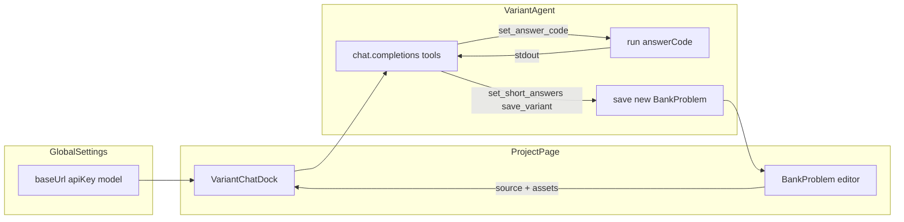

# AI 변형 문제 · 전역 엔드포인트 · 단답/스타터 정리

## 결정된 접근

- AI: **OpenAI 호환** `POST {baseUrl}/chat/completions` (브라우저에서 직접 호출). baseUrl / apiKey / model을 IndexedDB에 저장.
- 변형: 원본 `BankProblem`을 컨텍스트로 두고 **새 bank 항목**을 만들고 `assetIds`는 원본과 동일하게 유지. `sourceProblemId`로 원본 연결.
- 에이전트: function tools 루프. 정답 숫자는 LLM이 채우지 않고 **`answerCode` 작성 → 클라이언트에서 Pyodide/webR 실행 → stdout으로 `shortAnswers` 채움**.
- CORS: 엔드포인트가 브라우저 CORS를 허용해야 함(로컬 프록시·Ollama·호환 게이트웨이 등). 설정 UI에 짧은 안내만 표시.

## 아키텍처

## 1. 전역 AI 설정

- [`src/lib/idb.ts`](src/lib/idb.ts): `IdbKey`에 `'aiSettings'` 추가.
- 신규 [`src/lib/aiSettings.ts`](src/lib/aiSettings.ts): `{ baseUrl, apiKey, model }` 로드/저장/정규화.
- 신규 [`src/components/settings/GlobalSettingsModal.tsx`](src/components/settings/GlobalSettingsModal.tsx): base URL, API key, model 입력 + 연결 테스트(가벼운 models 또는 더미 chat).
- [`src/pages/HomePage.tsx`](src/pages/HomePage.tsx), [`src/pages/ProjectPage.tsx`](src/pages/ProjectPage.tsx) 헤더에 **설정** 진입점 추가(기존 테마 토글과 별도).

## 2. 데이터 모델

[`src/types/project.ts`](src/types/project.ts) `BankProblem`에:

- `sourceProblemId?: string` — 변형이면 원본 id
- 기존 `shortAnswers?: string[]`를 작성 UI의 주 단답 소스로 사용(단일 `shortAnswer`는 하위 호환/동기화)

[`src/lib/projectIO.ts`](src/lib/projectIO.ts) `validateProject` / `createEmptyBankProblem` / `duplicateBankProblem`에 필드 반영. ZIP export는 기존 bank 직렬화에 자연 포함.

채팅 기록은 프로젝트 ZIP과 분리해 IndexedDB `variantChats` 맵으로 저장: `{ [sourceProblemId]: { messages, draft?, updatedAt } }`.

## 3. Variant 채팅 Dock + 에이전트

신규 파일:

- [`src/lib/ai/openaiCompatible.ts`](src/lib/ai/openaiCompatible.ts) — chat completions + tool_calls 파싱
- [`src/lib/ai/variantAgent.ts`](src/lib/ai/variantAgent.ts) — 시스템 프롬프트, 툴 정의, 툴 실행 루프
- [`src/components/project/VariantChatDock.tsx`](src/components/project/VariantChatDock.tsx) — 우측 Dock(채팅 로그 / 입력 / 저장·닫기)

**툴(클라이언트 실행):**

| tool | 동작 |
|------|------|
| `update_draft` | 제목·markdown·note·language 초안 갱신(정답 숫자 직접 금지) |
| `set_answer_code` | `answerCode.python` / `r` 설정(연산용 코드) |
| `run_answer_code` | 원본과 동일 `assetIds` 마운트 후 실행, stdout/stderr를 툴 결과로 반환 |
| `set_short_answers` | 유형 1·3만; 실행 결과 기반 단답 배열 설정 |
| `save_variant` | `createEmptyBankProblem` + 초안 반영 → `addBankProblem`, `sourceProblemId` 설정 |

시스템 프롬프트 요지: 같은 CSV로 조건·집계·파생 피처 등을 바꾼 **변형 문항** 작성; 최종 숫자는 코드 실행으로만; 유형 2는 CSV/`gradingCode` 중심, 단답 툴 사용 금지.

**UI 진입:** 뱅크 에디터 헤더에 **변형 만들기** → Dock 오픈(선택 중인 문제가 원본). Dock 너비 리사이즈 가능, 열리면 메인 편집 영역이 줄어듦.

## 4. 프로젝트에서 스타터 코드 UI 제거

- [`src/pages/ProjectPage.tsx`](src/pages/ProjectPage.tsx)의 스타터 `edit-card`(약 707–739행) 삭제.
- `patchWithStarter`는 내부적으로 `buildStarterCode`만 유지하거나, asset/유형 변경 시 silent 갱신만 하고 에디터는 노출하지 않음.
- 시험 export의 [`materializeExam`](src/lib/projectIO.ts) 자동 스타터 생성은 유지(응시자용).

## 5. 코드 답안 ↔ 단답 (유형 1·3만)

[`src/components/project/AnswerAuthorPanel.tsx`](src/components/project/AnswerAuthorPanel.tsx) 개편:

- **유형 2 / csv:** 단답 탭·입력 완전 비활성(현재 `csvMode` 강화 + 안내 문구).
- **유형 1·3:** 코드 답안과 단답을 함께 표시.
  - `shortAnswers[]` 입력(추가/삭제) + 단일값 하위 호환 시 `shortAnswer`와 동기화.
  - **미리 실행** 후 stdout에서 **복사하여 단답에 넣기**(라인/전체) 버튼.
  - 단답 필드 직접 입력·클립보드 복사 버튼.

## 6. 스타일

[`src/styles/app.css`](src/styles/app.css): `.variant-dock`, 메시지 버블, 설정 모달 필드. 제출 페이지 force-light와 무관(프로젝트 작성 UI).

## 주요 터치 파일

- 설정/AI: `idb.ts`, `aiSettings.ts`, `GlobalSettingsModal.tsx`, `openaiCompatible.ts`, `variantAgent.ts`
- UI: `VariantChatDock.tsx`, `ProjectPage.tsx`, `HomePage.tsx`, `AnswerAuthorPanel.tsx`, `app.css`
- 모델/IO: `types/project.ts`, `projectIO.ts`
